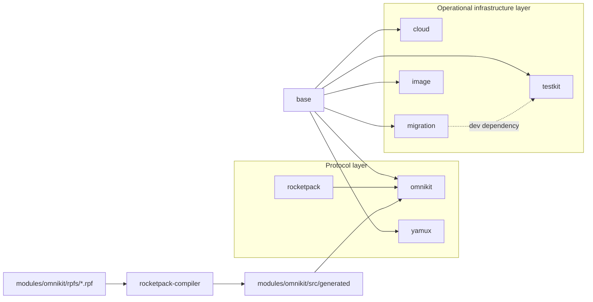
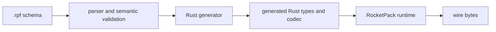
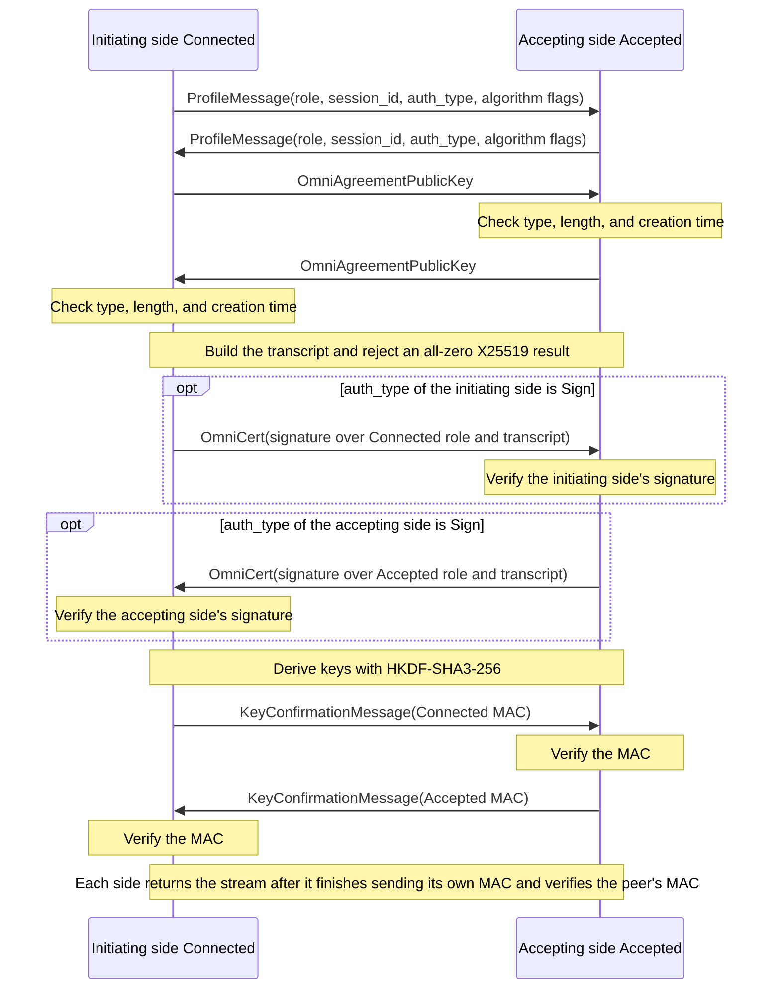

# core-rs design document

## 1. About this document

This document covers the responsibility boundaries, invariants, design decisions, and implementation status of the crates (`omnius-core-*`) and entrypoints that make up the core-rs workspace.
The intended readers are implementers and reviewers who change any of the crates or entrypoints.

### 1.1 Division of responsibility between documents

| Document or source of truth | What it covers |
| --- | --- |
| This document | The structure of the whole workspace, responsibility boundaries between crates, invariants, design decisions, and implementation status |
| [ISSUES.md](./ISSUES.md) | A working list of clear defects confirmed in the code, kept until they are filed |
| [RocketPack compiler design](./design/rocketpack-compiler.md) | Responsibilities, invariants, design decisions, and implementation status specific to the compiler |
| [entrypoints/rocketpack-compiler](../entrypoints/rocketpack-compiler) | The implementation of `.rpf` syntax, semantic checks, and Rust code generation |
| [modules/rocketpack](../modules/rocketpack) | The implementation of the wire codec and the runtime API used by generated code |
| [modules/omnikit/rpfs](../modules/omnikit/rpfs) | The source of truth for the `.rpf` schemas used by the omnikit protocol |
| [entrypoints/rocketpack-compiled-example/showcase/rpfs](../entrypoints/rocketpack-compiled-example/showcase/rpfs) | The source of truth for the `.rpf` schemas used by the generated example |
| [README.md](../README.md) | The project overview and links to external documents |

### 1.2 Tense used in this document

The body describes the agreed finished design in the present tense.
The implementation status and remaining work are collected in §12.
Read §12 first to find out what works today.

## 2. What core-rs is

core-rs is a workspace of Rust crates shared by the products of Omnius Labs.
It provides, as independent crates, the network-related crates (a custom wire codec, RocketPack, plus secure connections and remote calls built on it, omnikit, and stream multiplexing, yamux) and the operational infrastructure (cloud service integration, DB migration, and so on: cloud, migration, testkit).

### 2.1 Out of scope

- Each crate is a library and has no executable binary of a standalone server or daemon.
  Only `rocketpack-compiler` is an exception and has a binary as a CLI that generates code from schemas, but it is a compile-time tool and not a server that serves anything at runtime.
  Because there is no such binary, this document does not cover process startup or deployment methods.
- There is no implementation of a P2P node or server that actually speaks the omnikit protocol.
  Because there is none, node discovery and network topology design are out of scope for this document.
- cloud and migration are not used by other crates in the workspace.
  Because the `#[ignore]` integration tests of cloud contain resource names specific to external products, such as `opxs-dev` and `opxs-batch-email-send-sqs`, they appear to be intended for individual use by downstream applications outside core-rs (the code does not say so explicitly).
  Because they are not used internally, this document does not cover the domain logic of those applications or how they manage credentials.
- There are no RocketPack generators for C# and Swift.
  `rocketpack-compiler` implements generation for Rust only.
  Because of this, this document does not define a generation API for other languages or how to verify it.

## 3. Overall structure

### 3.1 Components and directory mapping

| Path | package | Role |
| --- | --- | --- |
| [modules/base](../modules/base) | `omnius-core-base` | The foundation that cloud, image, migration, omnikit, testkit, and yamux depend on (`Clock`, the `OmniError` contract, file lock, sleeper, tsid, and so on) |
| [modules/rocketpack](../modules/rocketpack) | `omnius-core-rocketpack` | The wire codec and the runtime contract of `RocketPackStruct` |
| [modules/omnikit](../modules/omnikit) | `omnius-core-omnikit` | Secure connections and remote calls built on RocketPack (the omnikit protocol) |
| [modules/yamux](../modules/yamux) | `omnius-core-yamux` | A Tokio wrapper for yamux stream multiplexing |
| [modules/cloud](../modules/cloud) | `omnius-core-cloud` | Thin wrappers for AWS (S3, Secrets Manager, SES, SQS) and GCP (Secret Manager) |
| [modules/migration](../modules/migration) | `omnius-core-migration` | A custom migration runner for PostgreSQL and SQLite |
| [modules/testkit](../modules/testkit) | `omnius-core-testkit` | Helpers that start Docker containers for integration tests |
| [modules/image](../modules/image) | `omnius-core-image` | A crate that declares only the dependencies related to EXIF metadata (details in §12) |
| [entrypoints/rocketpack-compiler](../entrypoints/rocketpack-compiler) | `omnius-core-rocketpack-compiler` | A CLI that performs `.rpf` parsing, semantic checks, and Rust code generation |
| [entrypoints/rocketpack-compiled-example](../entrypoints/rocketpack-compiled-example) | Not applicable (excluded from the workspace) | Sample projects for real examples of generated code and round-trip verification. The three projects `showcase`, `provider`, and `consumer` are laid out in the same structure, and `provider` and `consumer` verify path dependencies between manifests |

### 3.2 Processing flow



rocketpack and rocketpack-compiler do not depend on base and do not follow the OmniError contract (§4.1).
yamux is an independent crate that depends only on base, and it is not wired to the remoting layer of omnikit.
How to multiplex the remoting layer is deferred in §11.2.

## 4. Core concepts

### 4.1 OmniError

**OmniError** is the common error contract that a crate implements for its own error type.
In code, it is the trait `omnius_core_base::error::OmniError`, which has the associated type `ErrorKind`, the API `new`, `from_error`, `with_message`, `kind`, `message`, and `backtrace`, and a default `fmt` for the `Debug` format.
`cloud`, `migration`, `omnikit`, `testkit`, and `yamux` each provide an independent pair of `crate::error::Error` and `crate::error::ErrorKind` that implements this trait, and re-export `crate::result::Result<T>`, an alias for that `Error`, from `crate::prelude`.
`rocketpack` and `rocketpack-compiler` do not follow this convention and directly use dedicated error types defined with `thiserror::Error` (such as `RocketPackEncoderError`).
OmniError is a trait and not a concrete type, so there is no single Error type shared by the whole workspace.

### 4.2 RocketPackStruct

**RocketPackStruct** is the contract implemented by structs that pack a value onto the wire and unpack it from the wire.
In code, it is the trait `omnius_core_rocketpack::RocketPackStruct`, which has `validate`, `pack`, `unpack`, `import`, and `export`.
All Rust types generated by `rocketpack-compiler` implement this trait.
The remoting layer of omnikit (`OmniRemotingStream::send` and `recv`) sends and receives any generated message type as generic functions that have this trait as a type bound.
A schema is the input from which an implementation of this trait is generated, and RocketPackStruct is the contract that the generated output side satisfies.

### 4.3 Schema

A **schema** is the set of packages, types, field tags, constants, and constraints written in `.rpf`.
The `.rpf` is the source of truth, and the generated Rust code is a derived artifact that can be regenerated from the schema.
[modules/omnikit/rpfs](../modules/omnikit/rpfs) and [entrypoints/rocketpack-compiled-example/showcase/rpfs](../entrypoints/rocketpack-compiled-example/showcase/rpfs) are the sources of truth for the schemas used by the omnikit protocol and the generated example, respectively.

### 4.4 Constraints on variable-length types

A **constraint on a variable-length type** is the inclusive range of lengths that a `string`, `bytes`, `Vec`, or `Map` value can take.
The length of `string` and `bytes` is the number of bytes, that of `Vec` is the number of elements, and that of `Map` is the number of entries on the wire.
`Option` expresses only the presence or absence of a value, and the outer length of a fixed-length array is determined by the type, so only the variable-length types they contain have constraints.
A constraint is optional at each occurrence.
A variable-length type written without a constraint is called an **unconstrained variable-length type**, and the schema does not limit the length of its values.
The only upper limit that remains for an unconstrained variable-length type is the check that the decoder performs against the number of remaining input bytes (§5.3).

## 5. RocketPack

RocketPack is a mechanism that generates Rust data types and a wire codec from `.rpf` schemas.
The schema defines the field tags and types on the wire, and the runtime reads and writes CBOR-compatible length representations.
The total byte count of a message, the total number of elements, and the nesting depth are separate constraints of the codec or the transport and are not folded into per-field length constraints (see [Limit length constraints to each value](#d-per-value-scope) in §11.1).
The migration of `.rpf` files outside core-rs is owned by each repository, and core-rs has no mechanism to synchronize across repositories.

### 5.1 Components and directory mapping

| Path | package | Role |
| --- | --- | --- |
| [modules/rocketpack](../modules/rocketpack) | `omnius-core-rocketpack` | The encoder, the decoder, and the runtime contract of `RocketPackStruct` |
| [entrypoints/rocketpack-compiler](../entrypoints/rocketpack-compiler) | `omnius-core-rocketpack-compiler` | `.rpf` parsing, semantic checks, and Rust code generation |
| [modules/omnikit/rpfs](../modules/omnikit/rpfs) | Not applicable | The source of truth for the schemas used by the omnikit protocol |
| [modules/omnikit/rocketpack.yaml](../modules/omnikit/rocketpack.yaml) | Not applicable | The schema module manifest of omnikit. It generates all `.rpf` files under `rpfs` into [modules/omnikit/src/generated](../modules/omnikit/src/generated) |
| [gen-rocketpack.sh](../gen-rocketpack.sh) | Not applicable | A script that runs `rocketpack-compiler` from the repository root to update the generated code of omnikit |
| [entrypoints/rocketpack-compiled-example/showcase/rpfs](../entrypoints/rocketpack-compiled-example/showcase/rpfs) | Not applicable | The source of truth for the schemas used by the generated example |
| [entrypoints/rocketpack-compiled-example/showcase/rust/gen](../entrypoints/rocketpack-compiled-example/showcase/rust/gen) | `rocketpack-showcase` | Rust code output by the compiler, which is never edited by hand |



The compiler resolves the schema constraints once and reflects them in the generated code and in the boundary checks of the runtime.
The generator dispatch of `rocketpack-compiler` actually generates only when the plugin id is `rocketpack-rust`.
`rocketpack-csharp` and `rocketpack-swift` are recognized, but they are skipped with a log message and nothing is generated.

### 5.2 At schema compile time

The compiler checks duplicate field tags and enum variant tags, constraints inside type aliases, and default literals before generation.
Duplicate tags are checked separately in struct fields, enum variants, and the fields inside a record variant.
For occurrences where a constraint is written, it additionally checks that the upper bound is finite, that the boundary values resolve, and that the range is ordered.
If any schema is invalid, it fails before writing any output.

### 5.3 At codec runtime

Generated fields keep standard Rust types such as `String`, `Vec`, and `BTreeMap`.
Encoding checks before writing the length prefix, and decoding checks the declared length before allocating a collection, iterating, or taking ownership of a payload.
A constraint violation is returned as a dedicated error that carries the schema path and the actual length.
Regardless of whether a constraint exists, the decoder checks that the declared length of an array or map fits in the number of remaining input bytes.
This check belongs to the integrity of the wire and not to constraints derived from the schema, so it is returned as an `UnexpectedEof` that has no schema path.

## 6. omnikit

omnikit is a crate that builds, on top of the messages defined with RocketPack ([modules/omnikit/rpfs](../modules/omnikit/rpfs)), a secure connection that performs key exchange and authenticated encryption, and function-level remote calls.

### 6.1 Layer structure

The following layers are stacked on a raw `T: AsyncRead + AsyncWrite` prepared by the caller (such as TCP or `tokio::io::duplex`).

```
layer 4: remoting (service/remoting)
         HelloMessage handshake and sending and receiving RocketPackStruct messages
----------------------------------------------------------------------
layer 3: secure connection (service/connection/secure)
         X25519 key exchange + HKDF + AES-256-GCM
----------------------------------------------------------------------
layer 2: framed codec (service/connection/codec)
         length delimited framing
----------------------------------------------------------------------
layer 1: raw AsyncRead + AsyncWrite (prepared by the caller)
```

Each layer is implemented as generic functions over the layer below, so the layers can be combined freely as far as the types are concerned.

### 6.2 secure connection

The handshake includes per-connection values of both sides in the signatures and the key derivation, and the key confirmation also checks the signer's public key.
`Authenticator::auth` in [auth.rs](../modules/omnikit/src/service/connection/secure/auth.rs) is responsible for this processing, and only the keys that succeed are passed to the encrypted frame layer.
V1 has only the procedure in this section and does not accept the old format or fall back to it.

#### API and connection direction

`OmniSecureStream::new` takes `stream`, `stream_type`, `max_frame_length`, `signer`, `require_peer_signature: bool`, `max_clock_skew: std::time::Duration`, `clock`, and `rng` in this order.
The initiating side specifies `OmniSecureStreamType::Connected`, and the accepting side specifies `Accepted`.
The roles are represented by the 1-byte values `0x01` and `0x02`, respectively, and are also included in `ProfileMessage`.
The schema type of `role` in `ProfileMessage` is `u8`, and the value is checked after decoding.
A connection where the peer sends the same role as its own or an unknown role is rejected.

If there is a `signer`, its own `auth_type` is `Sign`; otherwise it is `None`.
The side with `require_peer_signature` set to `true` rejects the peer if the peer's profile is `None`.
Even when it is `false`, if the peer declares `Sign`, receiving and verifying the cert is mandatory.
Whether it signs itself and whether it requires a signature from the peer are independent, and `AuthType::None` can be used for an anonymous key exchange.

After success, `peer_cert(&self) -> Option<&OmniCert>` returns the peer's cert, which was verified in the handshake and whose public key was also checked in the key confirmation.
If the peer is `None`, it returns `None`.
`sign_id()` returns a display string built from that cert.
The caller decides whether the peer is the expected one by comparing the `public_key` of the returned cert with a known public key, and the `name` of the cert, which is not covered by the signature, is not treated as authenticated identity information.

#### Message order



In each of the profile and ephemeral public key stages, the initiating side sends without waiting for the peer's message of the same stage, and the accepting side sends its own message after receiving and checking it.
Each side finishes sending and receiving profiles and checking the peer's profile before moving on to the ephemeral public key stage, and satisfies the same condition for the ephemeral public keys before moving on to the cert stage.
In the cert stage, if the initiating side is `Sign`, it sends its cert first; the accepting side receives and verifies it, and then sends its own cert if it is also `Sign`.
If the initiating side is `None`, the accepting side does not wait for the initiating side's cert and sends a cert only if it is `Sign`. A side whose peer is `None` does not wait for the peer's cert, and if both sides are `None`, the cert stage is skipped.
The key confirmation is serial: the initiating side sends its MAC, and the accepting side receives and verifies it before sending its own MAC.
For each send, the peer performs a receive, and neither a state where both sides wait to receive at the same stage nor a state where both sides wait only for the send to complete is created, so no deadlock from mutual waiting occurs.

Each connection generates a fresh random 32-byte `session_id` and an X25519 ephemeral key pair, and never reuses them.
Each of the four algorithm flags in the profile accepts only `1`, which means X25519, HKDF, AES-256-GCM, and SHA3-256 are used.
Only `OmniSignType::Ed25519_Sha3_256_Base64Url` is accepted for signatures.

Each handshake message is in plaintext and is carried in a frame consisting of a 4-byte little-endian length and a RocketPack payload.
The auth layer checks the length against `max_frame_length` before allocating the payload, and reads only up to the end of that message.
It does not read ahead into the bytes that follow the last key confirmation, and it flushes the send after every message.
As a result, the encrypted frames after the handshake remain unread in the lower stream.

#### Transcript and signatures

`||` denotes byte string concatenation, `C` denotes the initiating side, and `A` denotes the accepting side.
`b"...\0"` below is an ASCII byte string followed by one trailing NUL byte, and integers and fixed-length values carry no length prefix.
The transcript `T` is built in the following order regardless of the viewpoint of sending or receiving.

```text
P_X = session_id[32]
      || auth_type(u32 LE)
      || key_exchange_algorithm_type_flags(u32 LE)
      || key_derivation_algorithm_type_flags(u32 LE)
      || cipher_algorithm_type_flags(u32 LE)
      || hash_algorithm_type_flags(u32 LE)
E_X = created_time.seconds(i64 BE)
      || agreement_algorithm_type(u32 LE)
      || public_key[32]
T   = b"OmniSecureStream/V1/transcript\0"
      || 0x01 || P_C || E_C
      || 0x02 || P_A || E_A
```

`auth_type` is `None=1` and `Sign=2`, and `agreement_algorithm_type` is `X25519=2`.
The role in the profile corresponds to `0x01` and `0x02` in `T`, and the creation time is a UTC Unix timestamp in seconds.
The transcript does not use the whole wire `export()` or a replacement with values chosen after receipt, and includes the semantic fields that both sides sent and received as they are.

The signature preimage for role `r` is `b"OmniSecureStream/V1/signature\0" || r || T`.
The 32 bytes of its SHA3-256 hash are signed with `OmniSigner::sign`, and the peer computes the same hash with the peer's role and passes it to `OmniCert::verify`.
The purpose prefix and the role prevent a signature made for another purpose or in the opposite direction from being reused.
Replaying a recorded signature is detected as a transcript mismatch, on the premise that the receiving side chooses a new value for each connection.

#### Creation time and X25519 checks

Immediately after receiving the ephemeral public key, and before sending or verifying signatures and deriving keys, it checks that the algorithm is X25519 and that the public key is 32 bytes.
At the same position, it computes the absolute difference between the UTC Unix seconds of `clock.now()` and `created_time.seconds`, and rejects the connection if the difference exceeds `max_clock_skew`.
The past and the future are checked by the same criterion, and a difference equal to the boundary value is accepted.
The difference is computed in `i128` so that even extreme `i64` timestamps do not overflow.
The tolerance is limited to whole seconds, and a `Duration` with a fractional part is rejected by the constructor. 0 seconds can also be specified, and there is no default value or value that disables the check.
The generating side also uses the Unix seconds of the same clock as the creation time of its ephemeral key.

If the 32 bytes of the X25519 shared secret are all 0, `OmniAgreement::gen_secret` rejects it and it is not passed to HKDF.
A connection whose clock skew exceeds the tolerance cannot be established, and detecting a replay within the tolerance depends on the new `session_id` and ephemeral keys.

#### HKDF and key confirmation

HKDF-SHA3-256 expands 152 bytes at once, using the X25519 shared secret as the IKM, the 64 bytes of `session_id_C || session_id_A` as the salt, and `b"OmniSecureStream/V1/keys\0" || SHA3-256(T)` as the info.
The output is split in the following order.

| Byte range (end exclusive) | Purpose |
| --- | --- |
| `[0, 32)` | AES key for frames from the initiating side to the accepting side |
| `[32, 44)` | Initial nonce for frames in the same direction |
| `[44, 76)` | AES key for frames from the accepting side to the initiating side |
| `[76, 88)` | Initial nonce for frames in the same direction |
| `[88, 120)` | MAC key `K_C` for the initiating side's key confirmation |
| `[120, 152)` | MAC key `K_A` for the accepting side's key confirmation |

The initiating side uses the first frame key and nonce for encoding and the next pair for decoding, and the accepting side uses them the other way around.
Key confirmation uses dedicated MAC keys and does not consume the frame keys and nonces.
The salt is built from a per-connection random value chosen independently of the ephemeral keys, and the info binds the keys to the purpose and the transcript.
The roles of the salt and the info follow [RFC 5869 §2–3](https://www.rfc-editor.org/rfc/rfc5869.html#section-2).

The subject of the key confirmation includes `T` and the signing public key slots `I_C` and `I_A`, arranged in the order of the initiating side and the accepting side.
Its own slot is built from the cert it sent, and the peer's slot is built from the verified cert it received; the slot value declared by the peer is not used.

```text
I_X (None) = 0x00
I_X (Sign) = 0x01 || cert.typ(u32 LE)
             || cert.public_key.len(u32 LE) || cert.public_key
M_r = b"OmniSecureStream/V1/confirmation\0" || r || T || I_C || I_A
MAC_r = HMAC-SHA3-256(K_r, M_r)
```

`cert.typ` is `Ed25519_Sha3_256_Base64Url=2`, and the public key uses the DER byte string contained in the cert as it is.
The schema of `KeyConfirmationMessage` has only one field, `@1 mac: bytes[32..=32];`.
`KeyConfirmationMessage` holds the 32 bytes of this MAC, and the receiving side verifies it with the MAC key that corresponds to the peer's role and compares in constant time.
If only one side signs, only that side has a `Sign` slot, and if both sides are `None`, both slots are `0x00`.
If the signing public key is replaced with an intermediary's, the slots differ between the sender's own cert and the receiver's received cert, and the intermediary cannot pass the key confirmation unless it knows the shared secret.
When both sides are `None`, the key confirmation is still exchanged, but neither authentication of the peer's identity nor protection against an active man-in-the-middle attack is obtained.

#### Failure and the boundary with the frame layer

An invalid role, format, length, or time, a missing mandatory signature, a signature or MAC verification failure, and an all-zero shared secret are handshake failures, and `auth()` and `OmniSecureStream::new` return `Err`.
An unsupported algorithm is `ErrorKind::UnsupportedType` and any other check violation is `ErrorKind::InvalidFormat`; I/O errors and EOF are not converted into success either.
No failure notification or fallback is sent, and neither a successful stream nor the peer's cert is exposed.
The constructor owns the lower stream and drops the reader and writer it holds on failure.
The caller also closes the same connection without reusing it, and manages the deadline and the concurrency of the whole handshake.

The encrypted frame layer receives only one pair of a 32-byte AES-256-GCM key and a 12-byte initial nonce for each direction, and does not interpret the transcript or the cert.
The reads and writes in [stream.rs](../modules/omnikit/src/service/connection/secure/stream.rs) handle a little-endian 4-byte length plus the ciphertext and the 16-byte tag, and split the plaintext into chunks of at most 64 KiB.
If the lower stream returns EOF at a boundary where not a single byte of the next frame's header has been read, the read returns a 0-byte EOF, and subsequent reads also return EOF.
If EOF is received in the middle of a header or body, it returns `std::io::ErrorKind::UnexpectedEof`.
[encoder.rs](../modules/omnikit/src/service/connection/secure/encoder.rs) and [decoder.rs](../modules/omnikit/src/service/connection/secure/decoder.rs) advance the little-endian counter of [util.rs](../modules/omnikit/src/service/connection/secure/util.rs) from the initial nonce for each successful frame.
The new handshake also passes keys and nonces of the same lengths and does not advance the counter during key confirmation, so this layer needs no change.
`max_frame_length` applies only to the plaintext frames of the handshake, and the fixed 64 KiB split of the encrypted stream is unchanged.

**The AEAD nonce is not carried on the wire, and its uniqueness is maintained only by deterministically incrementing an independent counter for each direction by one per message.**
This premise depends on the lower stream being a reliable stream that guarantees ordering.
If it is used on a lower stream that does not guarantee ordering, the counters on both ends fall out of sync and decryption breaks down.

### 6.3 remoting

`OmniRemotingCaller` (the calling side) and `OmniRemotingListener` (the receiving side) handle only one function call per lower stream.
`OmniRemotingCaller::new` splits the stream into send and receive halves, sends `HelloMessage { version, function_id }`, and returns an `OmniRemotingCaller`.
The caller obtains an `OmniRemotingStream` from its `call_stream()` and uses it for sending and receiving.
`OmniRemotingListener::new` verifies the same `HelloMessage`, exposes the call target as `function_id()`, and then passes an `OmniRemotingStream` to `listen_stream(callback)` and calls the callback once.
The processing that actually branches on `function_id` to decide which function to call is the responsibility of code outside this remoting layer (the caller's implementation).
This form, where one call occupies one stream, is not suited to handling multiple calls at the same time over one secure connection (the multiplexing method is deferred in §11.2).

### 6.4 model

`model/omni_hash.rs`, `omni_sign.rs`, and `omni_agreement.rs` implement the business logic directly with `impl` on the wire structs `OmniHash`, `OmniSigner`, `OmniCert`, and `OmniAgreement*` that are generated from the `.rpf` files of the same names ([modules/omnikit/rpfs](../modules/omnikit/rpfs)).
No separate wrapper types are provided.

**The only path through which a type is referenced is the `generated` side, and the modules on the `model` side are not re-exported.**
Whether inside or outside the `crate`, they are referenced like `generated::omni_sign::OmniSigner`.
Inherent impls and trait impls in Rust are attached to the type and not to the module path, so even when the `impl` is written on the `model` side, it comes along with the type obtained through the path on the `generated` side.
These three `model` modules are only a place to put `impl`, and they are declared as private `mod` in [model.rs](../modules/omnikit/src/model.rs) to guarantee that they are never referenced.
The generator replaces everything under `src/generated` wholesale and refuses to overwrite files that do not start with `// @generated by rocketpack-compiler` (`validate_managed_target` in [codegen/rust.rs](../entrypoints/rocketpack-compiler/src/codegen/rust.rs)), so a hand-written `impl` cannot be placed in the same directory as the generated output.
The package name of the `.rpf`, the module name directly under `src/generated`, and the module name directly under `model` are the same.
`OmniHash::compute_hash` uses SHA3-256, `OmniSigner::sign` and `OmniCert::verify` use Ed25519 (`ed25519_dalek`), and `OmniAgreement::gen_secret` uses X25519 (`x25519_dalek`).
The `Display` of `OmniHash`, `OmniSigner`, and `OmniCert` goes through `OmniBase` in [service/converter/omni_base.rs](../modules/omnikit/src/service/converter/omni_base.rs) (multibase-compliant, where `f` is hex and `u` is base64url encoding).
`OmniHash` produces a human-readable string like `sha3_256:u<base64url>`, and `OmniSigner` and `OmniCert` produce one like `{name}@u<base64url(sha3_256(public_key))>`.

Only `OmniAddr` in `model/omni_addr.rs` is a hand-written value type with no corresponding generated type, and it is also the only one that remains a public module directly under `model`.
It parses an s-expression-like notation such as `tcp(ip4(...),port)` with `nom` and represents an endpoint.
It has nothing to do with `OmniBase` or cryptographic keys, and the only relation is the similar name.

## 7. yamux

`omnius-core-yamux` is a wrapper that wraps the external crate `yamux` (the implementation of stream multiplexing itself) as an actor-driven asynchronous API that goes through channels.
The external crate owns the management of frames, windows, and stream states, and this crate adds only the following two things.

- `YamuxConnection::new` spawns the driver task behind it with `tokio::spawn`, and the caller does not need to be aware of polling.
- `connect_stream` and `accept_stream` take `&self` and can be called concurrently from multiple tasks.
  Only the driver task makes changes to the actual `yamux::Connection`, and callers send requests over channels.

`YamuxConnection::new<S>` is a generic that requires `S: AsyncRead + AsyncWrite + Send + Unpin + 'static`, and it does not care about the type of the lower transport.
`close()` is a graceful close that sends a shutdown signal and waits for the driver task to finish.
`Drop` is a non-blocking fallback that aborts without waiting for the driver task, so when a graceful close is needed, `close().await` must be called explicitly.

`accept_backlog` is the upper limit on streams waiting to be accepted, and its default value is 256, the same as the upper limit on the number of streams that the external crate `yamux` opens without waiting for an ACK (`MAX_ACK_BACKLOG` = 256).
If the peer is the same implementation, the number of unacknowledged streams does not exceed this value, so the backlog does not overflow even when accept is delayed.
If the backlog overflows, that stream is dropped without being delivered, and the external crate sends an RST to the peer.
This is a rejection in line with the yamux rule that "a stream that cannot be accepted is rejected with an RST", and the peer observes it as a failure of open.

## 8. cloud

`omnius-core-cloud` is a wrapper that wraps the SDK clients of AWS (S3, Secrets Manager, SES, SQS) and GCP (Secret Manager) as pairs of a small trait and an `*Impl` struct.
Each feature independently repeats the same shape (a trait, an `*Impl` that holds the real client, and in some cases a `*Mock`).
There is no common parent trait or marker, and even for the same role, the trait names and signatures are defined separately, as with `SecretsReader` on the AWS side and `SecretReader` on the GCP side.
To write caller code that switches clouds by unifying the two, the caller has to provide its own unifying trait.

The mocks only record calls and replay responses.
Inputs are recorded in an `Arc<parking_lot::Mutex<Vec<Input>>>`, and methods with a return value `pop_front` from an `Arc<Mutex<VecDeque<T>>>` (returning a default value when it runs out).
They keep no state that imitates real storage or queues.

`SecretReaderImpl::read_value` on GCP creates a new API client on every call.
Each `*Impl` on the AWS side reuses the `Client` that the caller constructed and holds.

The `aws` feature and the `gcp` feature can be enabled independently, and the dependency crates of the disabled side are not included in compilation.

## 9. migration

`omnius-core-migration` is a migration runner hand-written for each of PostgreSQL and SQLite, without using `sqlx::migrate!`.
By recording in a history table, it is idempotent, so it does not reapply the same migration even when run again.

PostgreSQL (`postgres.rs`, `PostgresMigrator`) works with the following steps.

1. Create `_migrations` (the names of applied files) and `_semaphores` (exclusive rows that indicate a run in progress).
2. Read the directory that holds the migration files and use the lexicographic order of file names as the execution order.
3. If there are no unapplied files, finish without taking the lock.
4. Take the lock by inserting its own `username` into `_semaphores` as the primary key.
   If a row with the same `username` already exists, the insert fails.
5. For each unapplied file, open a transaction, execute the whole file with `tokio_postgres::batch_execute`, record it in the history, and commit.
   One file is the atomic unit.
6. Whether it succeeds or fails, delete the row in `_semaphores` to release the lock.

**This lock is not `pg_advisory_lock` but a custom implementation based on insert and delete on the `_semaphores` table.**
If the process crashes after acquiring the lock, the row in `_semaphores` has neither a TTL nor automatic cleanup, so the premise breaks in that later migrations can no longer take the lock for that `username`.

SQLite (`sqlite.rs`, `SqliteMigrator`) differs from PostgreSQL even in the execution engine.

- It uses `sqlx::SqlitePool`.
  The PostgreSQL side uses `tokio_postgres` directly and does not go through `sqlx`.
- The source of migrations is not a directory but a `Vec<MigrationRequest>` assembled and passed by the caller.
  The order is the order of the Vec as it is, and there is no sorting by file name.
- It has no exclusion mechanism equivalent to `_semaphores`.
- It naively splits the SQL of one file on `';'` and executes it one statement at a time.
  It does not distinguish `;` inside string literals or comments, so the split may differ from the intent for SQL that contains them.

`tests/postgres.rs`, which uses [modules/testkit](../modules/testkit), verifies against a real PostgreSQL on Docker that a migration succeeds, that it fails on a syntax error, and that it is idempotent when run twice.
This test is built only when both the `stable-test` and `postgres` features are enabled.

## 10. testkit

`omnius-core-testkit` is a helper that starts the Docker containers used by integration tests.
`containers::postgres::PostgresContainer` starts the `postgres` image with the `testcontainers` crate, waits for the log message that indicates startup has completed, and then builds the connection string.
The host of the connection string comes from `containers::endpoint::Endpoint`: it uses `TESTCONTAINERS_HOST_OVERRIDE` when that variable is set, and otherwise the host that `testcontainers` reports, which is the local machine for a local daemon, the daemon host for a remote one, and the bridge gateway when the tests run inside a container.
A Docker-in-Docker setup whose published ports are not on the test process's loopback sets the variable to the address of the container that runs the daemon.

## 11. Design decisions

### 11.1 Decided

#### Migrate the omnikit wire format with a flag day

**Decision**
The 1-based tags and enum-as-map of the RocketPack generated code are the only omnikit wire format.
Decoding the old hand-coded format, verifying old signatures, and reading values stored in the old format are not provided.

**Rationale**
No code path in the workspace reads the old format, and we prioritize keeping the current schema as the single source of truth over maintaining a dual decoder and version negotiation.

**Rejected alternative**
A compatible decoder for the old format would allow rolling deployment and migration of stored values, but it is not adopted because it would make the dual management of tags and enum representations permanent.

#### Fix the signature preimage to semantic fields

**Decision**
Secure auth builds the transcript in §6.2 from the semantic fields of the roles, profiles, and ephemeral public keys of both sides, in the order of the initiating side and the accepting side.
The signature covers the hash of a preimage to which a purpose prefix and the signer's role are added, and the hash of the same transcript is included in the HKDF info.
The HKDF salt is the concatenation of the random session IDs of both sides in the order of the initiating side and the accepting side.
The handshake completes only after a key confirmation with a dedicated MAC that includes the signing public keys of both sides succeeds.
The tolerance for the creation time and whether to require the peer's signature are decided by the caller, and an all-zero X25519 result is rejected.
This procedure replaces the old V1, and the encryption scheme of frames is kept.

**Rationale**
Signing the per-connection values and the direction of both sides detects tampering with the profile or the ephemeral public keys and replay of past signatures.
A key confirmation that includes the public keys detects a relay that swaps only the signature for another signer's, and also confirms that both sides hold the derived keys.
The purpose prefix prevents a signature from being reused for another purpose with the same signing key, and the time check rejects old keys beyond the tolerance without depending on per-connection values.
Fixing the semantic fields means the preimage does not change merely because the wire tag order or the serialization changes.
The encrypted frame layer can be used just by handing over keys and nonces, so there is no need to rebuild that layer to add the guarantees of the handshake.

**Rejected alternative**
Hashing the whole wire export is short to implement, but it is not adopted because a mere change of serialization invalidates signatures.
Signing only its own profile and ephemeral public key and using the XOR of the session IDs as the salt is not adopted, because the peer's values and the direction of the connection are not bound to the signature and a relay that swaps the signer cannot be detected.
Confirming keys over the transcript only is not adopted, because the signer's public key can be swapped while relaying the same ephemeral keys.
Performing the key confirmation with the AES key and nonce of the frames is not adopted, because it requires adjusting the counter handed to the frame layer.

<a id="d-rpf-length-syntax"></a>
#### Optionally append a finite inclusive range to variable-length types

**Decision**
Each occurrence of `string`, `bytes`, `Vec`, and `Map` can be followed by `[..=max]` or `[min..=max]`.
An occurrence without a range is an unconstrained variable-length type, and the schema does not limit its length.
A range, when written, must be inclusive and finite, and no unbounded upper limit or exclusive upper limit is accepted.
Constraints are placed individually on each variable-length type, even inside a nest.

**Rationale**
Binding the constraint to the type makes it syntactically clear whether it applies to the outer or the inner type, and lets the compiler uniformly check the finite maximum at the places where a range is written.
Forcing a range on values that have no basis for an upper limit makes schema authors write numbers without a basis, and the very fact that a constraint is written can no longer be trusted as a contract.
The presence or absence of brackets distinguishes "an upper limit was set" from "not set", so making it optional creates no ambiguity.

**Rejected alternative**
Requiring a range at every occurrence is not adopted for the reasons above.
An explicit syntax for unbounded such as `[..]` is not adopted, because it adds a notation synonymous with omitting the brackets.
Lower-bound-only ranges such as `[min..]` are not adopted, because they add branches to the existing runtime API and generated code that assume both ends, while `[min..=max]` can express the need when it arises.
Switching between required and optional through generator settings is not adopted, because the validity of the same `.rpf` would depend on settings and the schema would no longer be the source of truth.
Field attributes are not adopted, because specifying targets inside a nest gets complicated.
Named generic arguments are not adopted, because type arguments and configuration values would be mixed.
Bounded wrapper types are not adopted, because they make the generated API heavier.

<a id="d-codec-boundary-enforcement"></a>
#### Check standard Rust types at the codec boundary

**Decision**
Keep the standard Rust types of generated fields and check constraints in both encoding and decoding.

**Rationale**
While keeping the existing caller API, the same contract can reject sending an invalid value constructed locally and using an invalid value received from the wire.

**Rejected alternative**
Checking only on decode is not adopted, because an invalid local value could be written to the wire.
A wrapper type that cannot represent invalid values at construction is not adopted, because it changes existing field types.

<a id="d-declared-length-within-buffer"></a>
#### The decoder checks that the declared length fits in the remaining buffer

**Decision**
`read_array` and `read_map` return `UnexpectedEof` when the declared length they read exceeds the number of remaining input bytes.
This check works independently of schema constraints, and applies to unconstrained variable-length types and to callers that use the runtime API directly.

**Rationale**
The declared length of an array or map can take up to 8 bytes on the wire, so a 9-byte input can declare `u64::MAX` elements.
The generated decode allocates a collection using the declared length as the capacity, so without this check an allocation not proportional to the input length could be triggered from outside.
Each element occupies at least 1 byte on the wire, so the remaining byte count is a valid upper bound on the number of elements and rejects no valid input.
`read_bytes` and `read_string` already go through the same check at the point where they slice the payload from the input, so this decision fills the asymmetry that remained only for arrays and maps.

**Rejected alternative**
Clamping the declared length to the remaining byte count is not adopted, because it accepts invalid input as a shorter value instead of raising an error.
Placing the check in the generated code is not adopted, because it would not protect callers that use the runtime API directly, and the same check would be scattered across the generated output.
Giving the runtime an upper limit on the total byte count or the total number of elements of a message is not adopted, because it conflicts with [Limit length constraints to each value](#d-per-value-scope).

<a id="d-timestamp-builtins"></a>
#### Resolve Timestamp as a runtime built-in type

**Decision**
The unqualified and exactly matching `Timestamp64` and `Timestamp96` are reserved built-in types, and spellings that differ in case are not accepted as aliases.
A schema in which the short name of a struct, enum, type alias, or import collides with a reserved name is a compile error.
A qualified type of the same name is treated as an external type, and an import with an alias that is not a reserved name is accepted.
Built-in timestamps can be used in the type positions of fields, enum payloads, type aliases, `Option`, `Vec`, the key and value of `Map`, and fixed-length arrays.
The Rust generator resolves them to `omnius_core_rocketpack::primitive::Timestamp64` and `omnius_core_rocketpack::primitive::Timestamp96`, respectively, and delegates the generated validate, encode, and decode to the runtime's `RocketPackStruct`.
A default literal of a field that contains a timestamp after type alias resolution is rejected at schema compile time.
The runtime wrapper is required to implement only `Debug`, `Clone`, `PartialEq`, `Eq`, `PartialOrd`, and `Ord`, and the meaning of `Timestamp96.nanos` and the existing wire encoding are unchanged.

**Rationale**
The schema and the generated API keep the timestamp precision explicit, while the source of truth of the wire contract stays in one place in the runtime.
Rejecting collisions with reserved names before generation makes it unambiguous whether a name resolved to the built-in type or to a user-defined type.
The comparison traits of the runtime wrapper are limited to what is needed to satisfy the derive of generated types and the requirements for a `BTreeMap` key.

**Rejected alternative**
Aliases that differ in case or use snake case are not adopted, because they increase the schema notations that express the same type.
Implicit conversion to `DateTime<Utc>` is not adopted, because it obscures the correspondence between schema types and generated types.
Reimplementing the wire encoding inside the generator is not adopted, because it would be managed twice, in the runtime and in the generator.

<a id="d-bound-resolution"></a>
#### Limit the resolution scope of boundary values and type aliases

**Decision**
A boundary value is a numeric literal or an unsigned integer constant in the same package, and the type of the constant is limited to `u8`, `u16`, `u32`, and `u64`.
A type alias inherits the constraints inside its declaration, and the use site cannot append a range.
The same applies to an alias that wrote no range in its declaration, and the use site cannot give it a constraint for the first time either.
Default literals of `string` and `bytes` are checked at schema compile time.

**Rationale**
Representative values can be reused, while expression evaluation and constraint composition are kept out of the schema language.
The contract is determined uniquely by the alias name, so the same alias never allows a different length at each use site.

**Rejected alternative**
Imported consts, arithmetic expressions, negative numbers, and overriding constraints at the alias use site are not adopted, because they increase name resolution and precedence rules.
Allowing the use site to give constraints only to unconstrained aliases is not adopted, because whether it is allowed would not be known until the alias is resolved, and it would introduce constraint composition through the back door.

<a id="d-schema-version"></a>
#### Keep schema version 1 and the wire encoding

**Decision**
After introducing variable-length constraints, `.rpf` continues to use `version 1;` and the wire encoding is not changed.

**Rationale**
The schemas are not publicly released, and the constraints are a validation contract added on top of existing wire values.

**Rejected alternative**
Updating to `version 2;` is not adopted, because it would add a migration branch to internal schemas whose wire encoding does not change.

<a id="d-per-value-scope"></a>
#### Limit length constraints to each value

**Decision**
Length constraints apply to each variable-length value and do not aggregate the total byte count of a message, the total number of elements, or the nesting depth.

**Rationale**
The semantic upper limit of a field and the resource budget of the transport or of the decoder as a whole have different responsibilities.

**Rejected alternative**
Constraints on total size and nesting depth are not adopted, because they would mix another global policy into field types.

<a id="d-length-error-context"></a>
#### Report constraint violations with the full schema path

**Decision**
The encoder and decoder return `LengthOutOfRange` and carry, in `context`, a schema path determined at generation time, such as `Request.tags[]`, `Request.attributes.key`, or `Event.Upload.0`.

**Rationale**
Callers and tests can identify the violating location inside a nest without depending on parsing the error message string.

### 11.2 Deferred

#### How to multiplex the remoting layer of omnikit

**Current state**
`OmniRemotingCaller` and `OmniRemotingListener` handle only one function call per lower stream.
`omnius-core-yamux` can multiplex multiple streams over one lower connection, but omnikit does not depend on it, and they are not wired together.

**Why not decide now**
No caller implementation that actually uses the remoting layer exists in the workspace, and it is not settled whether concurrent calls are needed or whether one secure connection must be reused by multiple calls.

**Condition for deciding**
Decide when a concrete client or server implementation that uses the remoting of omnikit becomes necessary and it is settled whether multiple calls must be handled over one secure connection.

## 12. Current state and remaining work

The variable-length type constraints of RocketPack are optional, and both the constrained and unconstrained forms are reflected in the parser, the semantic checks, the Rust generator, and the boundary checks of the runtime.
`Timestamp64` and `Timestamp96` can be used in the Rust generator and in the generated example.
There is no remaining work for the decided contracts of §11.1 related to RocketPack.

The handshake in §6.2 is implemented.
Secure auth builds the transcript from the roles, profiles, and ephemeral public keys of both sides and includes it in the signatures and the HKDF info.
It supports requiring the peer's signature and obtaining the cert, and checks the tolerance of the creation time and an all-zero shared secret.
It exchanges the key confirmation that includes the signing public keys of both sides before returning the stream.
The role in the profile and the key confirmation message are in the schema and the generated types, and HMAC-SHA3-256 uses `hmac`, a direct dependency of the workspace and omnikit.

The keys and nonces of §6.2 can be used by the frame layer as they are.
The auth layer reads only the length of each message and does not read ahead into the encrypted frames that follow the last key confirmation.
The reads in `stream.rs` distinguish EOF at a frame boundary from `UnexpectedEof` in the middle of a header or body.

The secure connection layer and the remoting layer of omnikit each work on their own, but there is no implementation that wires the two together and performs remoting over a secure path.
There is also no wiring that multiplexes multiple calls with yamux (§11.2).
`omnius-core-yamux` itself is complete as a crate.

The mocks of `omnius-core-cloud` exist for `S3Client`, `SesSender`, and `SqsSender`, but not for `SecretsReader` (aws), `SqsReceiver`, and `SecretReader` (gcp).

`omnius-core-testkit` currently has only `containers::postgres`, and the only thing that depends on it is the integration tests of modules/migration.

`omnius-core-image` is a placeholder with no implementation.
The dependencies in `Cargo.toml` (such as `kamadak-exif` and `tokio-postgres`) appear to have been intended for extracting EXIF metadata and persisting it to PostgreSQL, but there is no implementation in the code (the code does not state the reason).

Confirmed defects are recorded in [ISSUES.md](./ISSUES.md).
