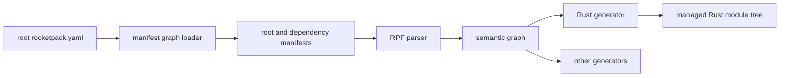

# RocketPack compiler design

## 1. About this document

This document defines the design of schema modules, dependency resolution, symbol resolution, and Rust module generation in the RocketPack compiler.
The intended readers are users who decide how to structure RPF files, and implementers who change the compiler and generators.

### 1.1 Division of responsibility between documents

| Document or definition | Responsibility |
| --- | --- |
| This document | Responsibilities of the components, invariants, design decisions, rationale, and deferred items |
| [ISSUES.md](../ISSUES.md) | Defects confirmed in the current code, tracked until they are fixed |
| [RPF parser](../../entrypoints/rocketpack-compiler/src/parser) | Source of truth for the concrete RPF syntax and the AST |
| [Example rocketpack.yaml](../../entrypoints/rocketpack-compiled-example/showcase/rocketpack.yaml) | A working example of the available settings |
| [README.md](../../README.md) | Entry point of the whole repository and external links |

This document does not duplicate the RPF field syntax, the wire encoding, or the CLI setup steps.

### 1.2 Tense used in this document

The body describes the finished design in the present tense.
The implementation status and the dependency order are collected in §11.

Read §11 first to find out what works today.

## 2. What the RocketPack compiler is

The RocketPack compiler is a tool that performs semantic analysis on one root manifest and the dependency graph of RPF schema modules that the manifest declares, and passes uniquely resolved type information to the per-language generators.
A single manifest can own multiple RPF files and multiple packages, but the generation targets are limited to the RPF files owned by the root manifest.
Path dependencies let it reference the schema of another crate on the local filesystem without copying it.

### 2.1 Out of scope

- Registries, Git URLs, version ranges, lockfiles, and dependency caches are not supported.
  Limiting the tool to path dependencies means it has no fetching or version selection mechanism and reads the local schema prepared by the consumer directly.
- Generators of dependency manifests are not executed.
  Separating schema dependencies from generation side effects keeps the output area of a dependency unchanged.
- Transitive dependencies cannot be referenced directly from the root.
  Requiring direct dependencies to be declared isolates the root's API from internal changes in a dependency.
- A Rust module cannot be placed at an arbitrary position deeper than the crate root.
  Fixing it directly under the crate root keeps the absolute paths emitted by the generator consistent with the actual module tree.

## 3. Overall structure

### 3.1 Components and directory mapping

| Path | Package name | Role |
| --- | --- | --- |
| [entrypoints/rocketpack-compiler](../../entrypoints/rocketpack-compiler) | `omnius-core-rocketpack-compiler` | Loads manifests, performs semantic analysis of RPF, and runs generators |
| [entrypoints/rocketpack-compiler/src/config.rs](../../entrypoints/rocketpack-compiler/src/config.rs) | `config` | Syntax model of the manifest and the entry point of the path dependency graph |
| [entrypoints/rocketpack-compiler/src/parser](../../entrypoints/rocketpack-compiler/src/parser) | `parser` | Converts RPF into an AST with source locations |
| [entrypoints/rocketpack-compiler/src/semantic.rs](../../entrypoints/rocketpack-compiler/src/semantic.rs) | `semantic` | Registers schema symbols, validates visibility, and resolves type references |
| [entrypoints/rocketpack-compiler/src/codegen](../../entrypoints/rocketpack-compiler/src/codegen) | `codegen` | Converts the semantic graph into per-language output |
| [entrypoints/rocketpack-compiled-example](../../entrypoints/rocketpack-compiled-example) | `rocketpack-showcase`, `rocketpack-provider`, `rocketpack-consumer` | Integration checks that embed the generated output into real Rust crates |
| [entrypoints/rocketpack-compiled-example/showcase/rust/gen](../../entrypoints/rocketpack-compiled-example/showcase/rust/gen) | Generated output | A Rust source tree owned exclusively by the generator and never edited by hand |

### 3.2 Processing flow

The dependencies run from the manifest graph to the semantic graph to the generators, and per-language settings do not affect schema identity.



## 4. Core concepts

### 4.1 Manifest module

A **manifest module** is one `rocketpack.yaml` together with the set of RPF files discovered by its `sources`.
In code, it corresponds to the manifest configuration type and the module node created after loading.
An RPF `package` is the logical namespace of types, whereas a manifest module is the unit of dependency and ownership, so the two are not the same thing.

### 4.2 Schema dependency

A **schema dependency** is a named directed edge to another manifest, declared in the top-level `dependencies` of a manifest.
Its external representation is a dependency name and a `path`; after loading, it becomes an edge that holds the module identities of the referrer and the referent.
It does not include YAML merging or generator inheritance.

### 4.3 Schema symbol

A **schema symbol** is an element of semantic analysis that uniquely identifies an RPF item as `package::Item`.
In code, it corresponds to a symbol entry holding the defining module, the defining RPF, the item kind, and the source span.
The Rust path is a derived value that the generator computes from the symbol entry, and it is not part of the schema symbol's identity.

### 4.4 Semantic graph

The **semantic graph** is a language-independent intermediate representation that gathers all loaded manifest modules, all RPF files, all schema symbols, and the resolved references.
Unlike a per-file AST, it can answer queries about the symbol owner in another RPF or in a direct dependency.
Generators do not reinterpret unvalidated RPF paths and use only the resolution results of this graph.

### 4.5 Rust module root

The **Rust module root** is the public module that the Rust generator's `module_name` specifies and that the consuming crate embeds directly under its crate root.
With `module_name: rocketpack`, the local path starts with `crate::rocketpack`.
RPF packages are mapped below this root, and RPF file names are not part of the public API.

### 4.6 Language dependency mapping

A **language dependency mapping** is a setting that maps a schema dependency name to a generator-specific external namespace.
For Rust, it holds the crate identifier visible to Cargo and the name of the RocketPack module that the crate exposes.
The top-level dependency decides whether a reference is possible, whereas this mapping decides only the paths inside the generated code.

## 5. Manifest dependency graph

Each manifest requires `version: 1` and a unique `name`.
A dependency key must match the `name` of the referenced manifest exactly, and `path` is resolved relative to the directory of the declaring manifest.

```yaml
version: 1
name: omnius-app-protocol

dependencies:
  omnius-core-protocol:
    path: ../core-protocol/rocketpack.yaml
```

The loader keeps the canonical manifest path and the declared name.
Loading fails as an identity conflict both when modules with the same name point to different canonical paths and when modules with different names point to the same canonical path.
A diamond, where multiple routes reach the same path under the same name, is merged into a single node.

Each module can reference only the symbols of itself and its direct dependencies.
The RPF files of transitive dependencies are also validated as part of the graph, but they do not become name resolution candidates unless the referencing module declares them directly.
A cycle fails regardless of whether any symbol in it is used, and the diagnostic shows the sequence of module names and manifest paths that form the cycle.

Only `name`, `dependencies`, `sources`, and the RPF files are taken from a dependency manifest.
The `generators` and `targets` on the dependency side are neither executed nor inherited.

## 6. Schema symbols and name resolution

Every RPF requires a `package`.
The fully qualified name of a symbol is the concatenation of the package segments and the item name, and if the same graph contains multiple symbols with the same name, it fails even when their contents are identical.
The diagnostic shows both module names, the RPF paths, and the source locations.

The lookup order for a simple name is built-in types, items in the same RPF, and then explicit `use` bindings of the same RPF.
Items in another RPF are not added as implicit candidates even when they are in the same package.
The side that references another RPF writes `use package::Type`, an aliased `use`, or the fully qualified name in the field type.

A `use` and a fully qualified reference fail unless they resolve to a symbol that actually exists in the semantic graph.
Multiple bindings that produce the same simple name, a collision between a local item and a binding, and a collision of public names after conversion to Rust identifiers also fail before generation.
Cycle detection for type aliases is performed on the reference chain of resolved symbols, not per file.

## 7. Rust module tree

The Rust generator targets all `sources` of the root manifest and does not build a subset with `targets[].pattern` or `targets[].options.dir`.
To change the generation targets, use `sources.includes` and `sources.excludes` of the root manifest, or split the manifest.

The generator options require `output_dir` and `module_name`.
`module_name` is validated to be a valid Rust identifier, and the consumer declares a module of that name exactly once directly under the crate root.
`output_dir` is limited to a relative path that stays within the directory of the root manifest, and absolute paths, traversal to a parent directory, and escapes outside the area through symlinks are rejected.

```yaml
generators:
  - id: rust
    plugin: rocketpack-rust
    options:
      output_dir: rust/gen/src
      module_name: rocketpack
```

```rust
#[path = "../gen/src/rocketpack.rs"]
pub mod rocketpack;
```

The output does not use `mod.rs` and follows the Rust 2018 and later convention of `<module_name>.rs` plus a directory of the same name.
For example, the package `omnius::core::v1` forms the following tree.

```text
rust/gen/src/
├── rocketpack.rs
└── rocketpack/
    ├── omnius.rs
    └── omnius/
        ├── core.rs
        └── core/
            ├── v1.rs
            └── v1/
                ├── source_1.rs
                └── source_2.rs
```

A package module declares the internal source modules privately and publicly re-exports the types directly under the package module.
The internal source module names are derived deterministically from the normalized module identity and the RPF relative path, and they do not appear in the public API.
Even when multiple RPF files extend the same package, the usage path remains `crate::rocketpack::omnius::core::v1::Type`.

The Rust path of a local symbol is `crate::<module_name>::<package>::<item>`.
The `use` string of the schema must not be emitted as a Rust `use` as it is.
The generator chooses a local path or an external path from the resolved symbol owner.

The root module `<module_name>.rs` pulls in `<module_name>/.root.rs` with `include!`, and the `pub mod` declarations of the root package are placed in `.root.rs`.
The consuming crate embeds `<module_name>.rs` into the crate root with `#[path]`, so the `include!` switches the base used to resolve submodules of the `pub mod` declarations it pulls in to `<module_name>/` (§10.1).

## 8. Ownership and publication of generated output

The permanent generated output that the Rust generator owns is only `<output_dir>/<module_name>.rs` and `<output_dir>/<module_name>/`.
It does not own or delete sibling files of `output_dir`.
The owned area carries a generation marker, and hand-written source must not be placed there.

During publication, `<output_dir>/.rocketpack-<module_name>.rs.backup`, `<output_dir>/.rocketpack-<module_name>.backup`, and `<output_dir>/.rocketpack-<module_name>.stage-*` are reserved as control paths.
The reserved names themselves are treated as a temporary area owned by the generator, and the files inside require the generator marker.
An empty directory can be recovered or removed, but if there is a symlink or a file without a marker, the operation is refused.

Existing generated output is not changed until semantic analysis, path validation, and rendering of all files succeed.
At publication time, all output is placed in a temporary area on the same filesystem, and the existing exclusive area is backed up and then replaced.
If the replacement fails, the backup is restored, and the next run identifies the interrupted temporary area and backup, and either recovers or fails explicitly.
This replacement assumes that the temporary area and the output destination are on the same filesystem, and output that crosses filesystems is not supported because of the constraint on `output_dir`.

Stale sources left after an RPF or package is deleted are not in the new tree, so they disappear along with the replacement.
This property holds on the premise that the generator changes nothing outside the exclusive area.

## 9. Mapping of external Rust types

The Rust generator's `options.dependencies` assigns each top-level dependency name a crate identifier visible to Cargo and a public module name.

```yaml
generators:
  - id: rust
    plugin: rocketpack-rust
    options:
      output_dir: rust/gen/src
      module_name: rocketpack
      dependencies:
        omnius-core-protocol:
          crate: omnius_core_protocol
          module_name: rocketpack
```

`omnius::core::v1::UserId`, owned by the dependency `omnius-core-protocol`, is mapped to `omnius_core_protocol::rocketpack::omnius::core::v1::UserId`.
`crate` is not the Cargo package name but the identifier that Rust source sees after the dependency rename is applied.

A mapping is required only when the root's generation targets use a symbol of the dependency.
The mapping of an unused dependency can be omitted.
If a dependency in use has no mapping, generation stops before it starts with a dedicated error that includes the dependency name, the schema symbol, and the referencing RPF.
A mapping for a dependency that does not exist at the top level, and an invalid Rust identifier, are configuration errors.

## 10. Design decisions

### 10.1 Decided

<a id="decision-manifest-dependencies"></a>
#### Adopt manifest dependencies instead of YAML composition

**Decision**
The top-level `dependencies` load the schema and recursive dependencies of another manifest, but do not take in its configuration mappings or generators.

**Rationale**
This separates schema referenceability from output side effects, so that the root cannot change where a dependency crate generates its output.

**Rejected alternative**
Including and merging YAML mappings is not adopted, because it raises the override order of generator options and output into the dependency.

<a id="decision-direct-dependencies"></a>
#### Limit the reference scope to direct dependencies

**Decision**
Each manifest module can reference only the symbols of itself and the dependencies it declares directly.

**Rationale**
This keeps transitive dependencies as implementation details of the dependency and shows the schemas used directly in the manifest.

**Rejected alternative**
Searching for names across the whole graph is not adopted, because an internal change in a dependency alone would change what the root can reference.

<a id="decision-symbol-identity"></a>
#### Make schema symbols unique by package and item name

**Decision**
Every RPF requires a package, and duplicate `package::Item` names and implicit references to another RPF are forbidden.

**Rationale**
This preserves a public identity that does not depend on file layout and keeps dependencies between RPF files explicit.

**Rejected alternative**
Putting all items of the same package in an implicit scope is not adopted, because adding a file would change how simple names resolve.

<a id="decision-rust-module-tree"></a>
#### The Rust generator owns a single module tree

**Decision**
The Rust generator emits all sources of the root into a tree in the `<module_name>.rs` form and does not include RPF file names in the public path.

**Rationale**
This makes schema symbols and Rust paths one-to-one and keeps the public API stable even when the same package is split across multiple RPF files.

**Rejected alternative**
Per-RPF `targets[].dir` and inline `pub mod` are not adopted, because the generator cannot guarantee the module root that is actually embedded in the consuming crate.
The `mod.rs` form is valid but is not adopted, because it multiplies files with the same name and the official Rust guidance recommends the newer naming convention.

<a id="decision-include-root-resolution"></a>
#### Fix the submodule resolution base of the root module with `include!`

**Decision**
The root module `<module_name>.rs` contains only `include!("<module_name>/.root.rs")`, and the `pub mod` declarations of the root package go in `<module_name>/.root.rs`.

**Rationale**
The consuming crate embeds `<module_name>.rs` into the crate root with `#[path]`.
If a module embedded with `#[path]` declares `pub mod <package>;` directly, rustc resolves the submodule relative to the parent directory of the `#[path]` file, looks for `<output_dir>/<package>.rs`, and fails with E0583.
Pulling in `<module_name>/.root.rs` with `include!` switches the base for resolving the `pub mod` declarations inside it to `<module_name>/`, so they resolve correctly to `<module_name>/<package>.rs`.
This absorbs the shift in the resolution base with `include!` while keeping the same-name file convention (§7).

**Rejected alternative**
Putting `pub mod` directly in `<module_name>.rs` as a single file is not adopted, because the submodule resolution base under `#[path]` shifts to `<output_dir>/` and breaks the build.
Moving to the `<module_name>/mod.rs` form solves the resolution base problem, but it gives up the same-name file convention and requires the consuming crate to change its `#[path]` to `mod.rs`, so the cost is too high and it is not adopted.

<a id="decision-language-mapping"></a>
#### Assign external namespaces through generator options

**Decision**
Top-level dependencies are language-independent, and the external crate path is specified in the dependency mapping of the Rust generator.

**Rationale**
A Cargo dependency alias and a Rust module name are not schema identity but circumstances specific to each target crate.

**Rejected alternative**
Putting the Rust crate name in the top-level dependency is not adopted, because it would conflict in configuration responsibility with the C# and Swift generators.

### 10.2 Deferred

#### Remote dependencies and lockfiles

**Current state**
Dependency sources are limited to manifest paths on the local filesystem.

**Why not decide now**
Path dependencies are enough to confirm that external Rust paths work, and there is no need to bring in the design of distribution, authentication, version selection, and caching at the same time.

**Condition for deciding**
Decide when a use case appears that needs to fetch a schema module that is not in the same source tree in a reproducible way.

The options are as follows.

1. Introduce a dedicated registry and content digests.
   Validation and distribution tailored to schemas can be unified, but running a registry becomes necessary.
2. Introduce Git references and a lockfile.
   Existing Git hosting can be used, but it depends on the repository layout and the authentication method.
3. Bundle the schema in a Cargo package and fetch it from there.
   Versions are easy to align in Rust, but it is no longer a language-independent dependency manager.

#### When a generator exposes multiple Rust module roots

**Current state**
One generator produces exactly one module root directly under the crate root.

**Why not decide now**
Splitting the manifest can produce different module roots, and one is enough for the current range of use.

**Condition for deciding**
Decide when the same root manifest and the same Rust crate need multiple independent public module roots.

## 11. Current state and remaining work

The current implementation builds the manifest graph and the semantic graph from the root and its recursive path dependencies, and generates all RPF files owned by the root into a single Rust module tree.
Other RPF files in the same manifest can be resolved with explicit `use`, aliases, and fully qualified names, and the types of direct dependencies can be connected to public types of another crate through the Rust generator's mapping.
The compiled example verifies encoding and decoding for both local multiple-RPF use and a provider/consumer pair that uses Cargo dependency aliases.

The C# and Swift generators are not connected to the semantic graph, and the current compiler skips their generator settings without executing them.

The order of the roadmap is provisional, and only the dependencies need to be respected.

| No. | Content | Prerequisite dependency |
| --- | --- | --- |
| 1 | Connect the C# and Swift generators to the semantic graph and the language dependency mapping | The implementation policy of the target generators is decided |
| 2 | Remote dependencies and lockfiles | The decision condition in §10.2 is met |

As design references, we consulted the separation of responsibilities between workspaces and external dependencies in Buf's [buf.yaml v2](https://buf.build/docs/configuration/v2/buf-yaml/) and [dependency management](https://buf.build/docs/bsr/module/dependency-management/).
The Rust file layout follows the [module source filenames in the Rust Reference](https://doc.rust-lang.org/stable/reference/items/modules.html#module-source-filenames).

Confirmed defects are recorded in [ISSUES.md](../ISSUES.md).
